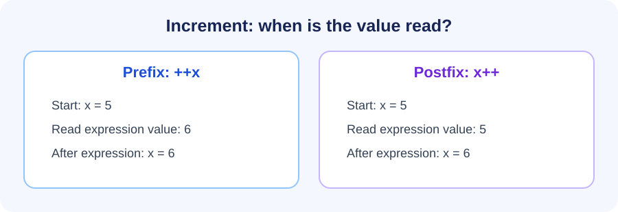
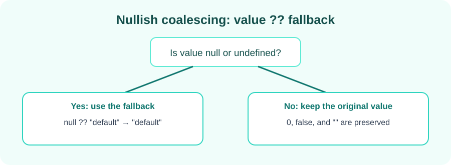

# Learn JavaScript / TypeScript

A collection of small JavaScript examples and practice exercises, organized by chapter.

## Increment, decrement, and nullish coalescing

The [`05_chapter_JS_Incre_Decr_Op`](./05_chapter_JS_Incre_Decr_Op/) folder contains examples of prefix and postfix increment/decrement, expression evaluation, and the nullish coalescing operator.

### Prefix and postfix operators

Prefix operators update a value before the expression uses it. Postfix operators use the current value first, then update it.



### Nullish coalescing

The `??` operator uses its fallback only when the value on the left is `null` or `undefined`. Values such as `0`, `false`, and an empty string are preserved.



Run an example from the repository root with Node.js:

```sh
node 05_chapter_JS_Incre_Decr_Op/45_Nullish.js
```
